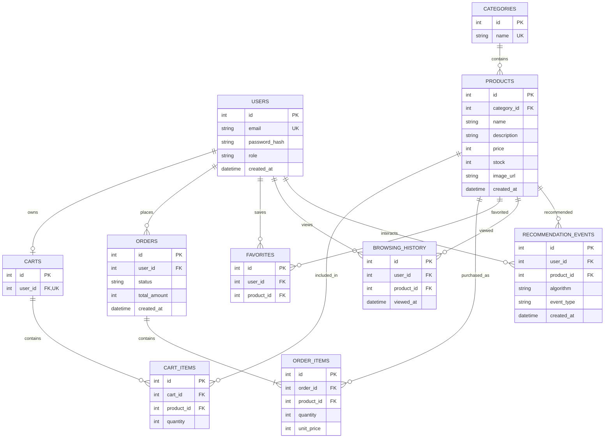

# RecoCommerce データベース設計書

## 1. 概要

RecoCommerceのデータベースには、商品・ユーザー・カート・注文・閲覧履歴・推薦履歴を保存する。

開発初期はSQLiteを使用し、PythonのSQLAlchemyから操作する。

## 2. ER図

## 3. 主キーと外部キー

### 主キー（Primary Key / PK）

各レコードを一意に識別するためのID。

例：products.id

### 外部キー（Foreign Key / FK）

別のテーブルのレコードを参照するためのカラム。

例：products.category_id は categories.id を参照する。

### ユニーク制約（Unique / UK）

重複してはいけない値に設定する制約。

例：users.email

## 4. データ設計ルール

- 金額は整数の円単位で保存する
- パスワードは平文では保存しない
- 商品の在庫数は0以上とする
- 注文時の商品単価はorder_itemsに記録する
- 注文合計金額は注文明細から算出する
- お気に入りはユーザーと商品の組み合わせを一意にする
- カート内の商品はカートと商品の組み合わせを一意にする
- 注文の作成と在庫更新はトランザクションで行う
- SQLiteでは接続ごとに外部キー制約を有効化する

## 5. 機械学習に利用するデータ

### 商品情報
- 商品名
- 商品説明
- カテゴリ
- 価格

### ユーザー行動情報
- 閲覧商品
- お気に入り商品
- 購入商品
- 推薦された商品
- 推薦商品のクリック

### 初期レコメンド方式

1. 同じカテゴリの商品を推薦する
2. 商品説明から特徴量を抽出する
3. コサイン類似度で類似商品を計算する
4. ユーザー行動履歴を使って推薦を改善する

## 6. 今後の検討事項

- 匿名ユーザーのカート管理
- 商品画像の保存先
- 注文キャンセル時の在庫復元
- 商品削除時の注文履歴の保持
- 推薦モデルのバージョン管理
- ML実験履歴の保存
- 個人情報の保存期間と削除方針